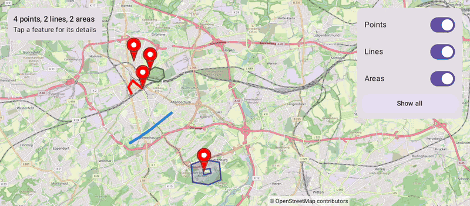

[](https://github.com/afarber/OpenMapView/actions/workflows/ci.yml)
[](https://github.com/afarber/OpenMapView/actions/workflows/daily.yml)
[](https://github.com/afarber/OpenMapView/actions/workflows/release.yml)
[](https://afarber.github.io/OpenMapView/)

# OpenMapView

A modern, Kotlin-first MapView replacement for Android - powered by [OpenStreetMap](https://www.openstreetmap.org/).

## Installation

Add to your `build.gradle.kts`:

```kotlin
dependencies {
    implementation("de.afarber:openmapview:0.23.0")

    // Optional: the OpenMap composable for Jetpack Compose
    implementation("de.afarber:openmapview-compose:0.23.0")
}
```

**Requirements:** minSdk 23, compileSdk 37, Android Gradle Plugin 9.1 or newer and Kotlin 2.3 or newer.

The library is available on [Maven Central](https://central.sonatype.com/artifact/de.afarber/openmapview). Alternative distribution via [JitPack](https://jitpack.io/#afarber/OpenMapView) is also supported.

## License

OpenMapView is MIT licensed, so you can use it in commercial apps. Its four runtime dependencies (androidx core-ktx, lifecycle-runtime-ktx, Compose ui-graphics and ktor-client-android) are all Apache 2.0. See the [Dependency License Report](https://afarber.github.io/OpenMapView/licenses/) for details.

## Features

- Drop-in compatible with the `MapView` API of the Maps SDK for Android (non-deprecated methods only)
- Lightweight, pure Kotlin implementation without Play Services
- OSM tiles via standard APIs (free, no API keys required)
- Smooth camera animations with customizable durations and callbacks
- Multiple overlay types: Markers, Polylines, Polygons, Circles, Ground Overlays, Tile Overlays, Info Windows
- Multiple map types (see [Map Types Guide](docs/MAP_TYPES.md))
- Built-in zoom controls (+/- buttons) via UiSettings
- External app integration (open in OsmAnd, Organic Maps and other map apps via geo: URI)
- GeoJSON import support
- Extensible marker, overlay, and gesture handling

## API Documentation

Full API reference documentation is available at [afarber.github.io/OpenMapView](https://afarber.github.io/OpenMapView/).

The documentation is generated from KDoc comments and redeployed whenever the library sources change on main.

## Examples

| Jetpack Compose (Kotlin) | Views with XML (Java) | Synopsis |
|---|---|---|
| [Pan](examples/compose/Pan) | [Pan](examples/views/Pan) | Panning by touch and arrow buttons, flying to places and keeping the camera inside bounds |
| [Zoom](examples/compose/Zoom) | [Zoom](examples/views/Zoom) | Smooth pinch zoom, zoom buttons and levels, zoom limits and why the camera moves |
| [Markers](examples/compose/Markers) | [Markers](examples/views/Markers) | Colored markers with info windows, stepping through them and keeping them clear of a side panel with map padding |
| [Polylines](examples/compose/Polylines) | [Polylines](examples/views/Polylines) | Lines, areas, a polygon with a hole and a geodesic flight, highlighted on tap through live shapes |
| [Camera](examples/compose/Camera) | [Camera](examples/views/Camera) | Camera flights with durations, finish and cancel callbacks, stopping and interrupting them |
| [Clicks](examples/compose/Clicks) | [Clicks](examples/views/Clicks) | Tap and long-press coordinates, a circle following taps and markers dropped by long press |
| [DraggableMarkers](examples/compose/DraggableMarkers) | [DraggableMarkers](examples/views/DraggableMarkers) | A route of draggable markers that the line follows while dragging, with drag events |
| [Circles](examples/compose/Circles) | [Circles](examples/views/Circles) | Circles with radii in meters, selected by tap and resized live with a slider |
| [Overlays](examples/compose/Overlays) | [Overlays](examples/views/Overlays) | Hiking, cycling and mountain bike tile overlays, turned on and off, with live transparency |
| [GroundOverlays](examples/compose/GroundOverlays) | [GroundOverlays](examples/views/GroundOverlays) | Site plans placed by position or bounds, rotated and made transparent live |
| [MapTypes](examples/compose/MapTypes) | [MapTypes](examples/views/MapTypes) | All 15 map types, their attribution and the notice for types that need an API key |
| [Toolbar](examples/compose/Toolbar) | [Toolbar](examples/views/Toolbar) | Open a picked or long-pressed place in another map app, with a browser and QR code fallback |
| [Tabs](examples/compose/Tabs) | [Tabs](examples/views/Tabs) | A map in a tab that keeps its camera, marker and route while other tabs are shown |
| [GeoJson](examples/compose/GeoJson) | [GeoJson](examples/views/GeoJson) | Points, lines and areas loaded from a GeoJSON file with their styles, tapped for details and fitted into view |
| [ScrollingPage](examples/compose/ScrollingPage) | [ScrollingPage](examples/views/ScrollingPage) | A static preview map that lets the page scroll over it and an interactive map inside a scrolling page |



## Documentation

- [Public API Compatibility](docs/PUBLIC_API.md) - API implementation status and compatibility matrix
- [Architecture](docs/ARCHITECTURE.md) - Architectural design and comparison with the Maps SDK
- [Migrating](docs/MIGRATING.md) - Migration guide for switching from the Maps SDK to OpenMapView
- [Map Types](docs/MAP_TYPES.md) - Available map types and tile sources
- [Map Toolbar](docs/MAP_TOOLBAR.md) - External map app integration using geo: URIs with browser fallback
- [Performance](docs/PERFORMANCE.md) - Performance optimization and benchmarking
- [Contributing Guide](docs/CONTRIBUTING.md) - Code quality requirements, formatting, git hooks, and PR process
- [Lifecycle Management](docs/LIFECYCLE.md) - How OpenMapView handles Android lifecycle events
- [Publishing Guide](docs/PUBLISHING.md) - Publishing to Maven Central and JitPack
- [GitHub Workflows](docs/GITHUB_WORKFLOWS.md) - CI/CD pipeline and workflow architecture
- [Unit Testing](docs/TESTING_UNIT.md) - JVM unit tests with Robolectric for Android framework APIs
- [Instrumented Testing](docs/TESTING_INSTRUMENTED.md) - On-device (phone and auto) testing with Android emulator

## Getting Started

### With Jetpack Compose (Kotlin)

The optional `openmapview-compose` artifact provides the `OpenMap` composable. Its camera is kept in a `CameraPositionState`, which survives configuration changes and, when hoisted above the screen, also switching tabs:

```kotlin
@Composable
fun MapScreen() {
    val cameraPositionState = rememberCameraPositionState {
        position = CameraPosition(LatLng(51.4661, 7.2491), 14f)
    }

    OpenMap(
        modifier = Modifier.fillMaxSize(),
        cameraPositionState = cameraPositionState,
        properties = MapProperties(mapType = MapType.CARTO_LIGHT, minZoomPreference = 10f),
        uiSettings = MapUiSettings(zoomControlsEnabled = true),
        onMapLongClick = { latLng -> /* ... */ },
    ) {
        // Dragging updates the state; setting state.position moves the marker
        val markerState = rememberMarkerState(LatLng(51.4661, 7.2491))
        Marker(state = markerState, title = "Bochum City Center", draggable = true)

        // Shapes are replaced when a parameter changes, so this circle follows the marker
        Circle(center = markerState.position, radius = 300f, fillColor = Color.Blue.copy(alpha = 0.2f))
        Polyline(points = route, strokeColor = Color.Red, clickable = true, onClick = { /* ... */ })
    }

    // Move the camera by setting cameraPositionState.position, or animate it
    // from a coroutine: cameraPositionState.animate(CameraUpdateFactory.zoomIn())
}
```

Content composables: `Marker`, `Polyline`, `Polygon`, `Circle`, `GroundOverlay` and `TileOverlay`. Their parameters match the model classes of the same names. `MarkerState.showInfoWindow()` opens a marker's info window, and `MarkerInfoWindow` and `MarkerInfoWindowContent` draw it with your own composables. `MarkerComposable` draws a marker icon from a composable, and `Clustering` groups many markers into clusters. `OpenMap` takes the map type, zoom limits, camera bounds and the my-location layer as `MapProperties`, the controls and gestures as `MapUiSettings`, and `onMapClick`, `onMapLongClick` and `onMapLoaded` callbacks. `ScaleBar` and `DisappearingScaleBar` show the map scale next to it. It sets the map's camera, marker and shape listeners itself, so use the composables' state and callbacks instead.

### With XML Layouts (Java)

```java
public class MainActivity extends AppCompatActivity {
    @Override
    protected void onCreate(Bundle savedInstanceState) {
        super.onCreate(savedInstanceState);
        setContentView(R.layout.activity_main);

        // Ready right away: no getMapAsync() and no lifecycle forwarding
        OpenMapView mapView = findViewById(R.id.mapView);
        mapView.moveCamera(CameraUpdateFactory.newLatLngZoom(new LatLng(51.4661, 7.2491), 14f));
        mapView.addMarker(new MarkerOptions()
                .position(new LatLng(51.4661, 7.2491))
                .title("Bochum City Center"));
    }
}
```
