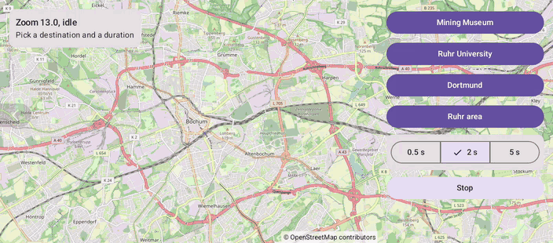

# Camera (Compose)

[Back to README](../../../README.md) | Same app with Views and Java: [Camera (Views)](../../views/Camera)

Fly to four destinations at different zoom levels, in 0.5, 2 or 5 seconds. Stop a flight, interrupt it with another one or with a tap on the map, and watch the results.
The map is the `OpenMap` composable from `de.afarber:openmapview-compose`.

## Features

- The suspending `CameraPositionState.animate(CameraUpdateFactory.newLatLngZoom(...), durationMs)`: the camera moves and zooms at the same time
- `animate()` returns when the flight is finished and throws a `CancellationException` when it is interrupted
- Stop cancels the flight's coroutine `Job`, which stops the animation; a new flight or a touch on the map cancels it too
- A status card that reads `position`, `isMoving` and `cameraMoveStartedReason`
- `OpenMap(contentPadding)` keeps the destination clear of the button panel

## Screenshot



## Run

Select `examples.compose.Camera` in Android Studio, or:

```bash
./gradlew :examples:compose:Camera:installDebug
adb shell am start -n de.afarber.openmapview.examples.compose.camera/.MainActivity
```

## Code Highlights

```kotlin
// The running flight: cancelling it stops the camera animation
var flight by remember { mutableStateOf<Job?>(null) }

flight = scope.launch {
    try {
        // Suspends until the animation is finished
        cameraPositionState.animate(CameraUpdateFactory.newLatLngZoom(destination.target, destination.zoom), durationMs)
        callback = "Finished: ${destination.name} in $label"
    } catch (e: CancellationException) {
        // A new flight, a tap on the map or Stop interrupts this one
        callback = "Canceled: ${destination.name}"
        throw e
    }
}

FilledTonalButton(onClick = { flight?.cancel() }) { Text("Stop") }
```

## What to Try

1. Pick 5 s and fly to Dortmund, then tap Stop halfway
2. Fly to the Ruhr area and tap Mining Museum before it arrives
3. Tap the map during a flight
