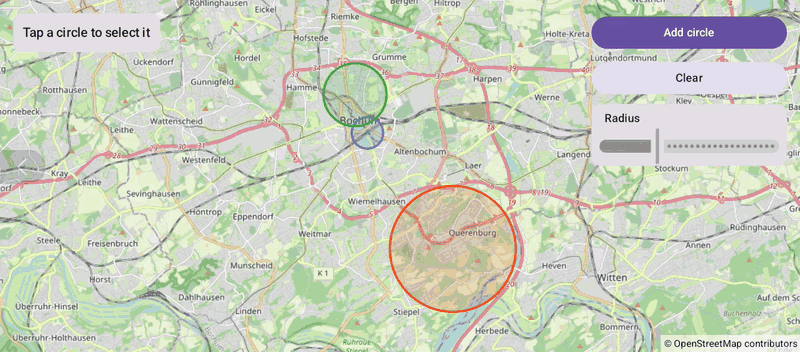

# Circles (Compose)

[Back to README](../../../README.md) | Same app with Views and Java: [Circles (Views)](../../views/Circles)

Circles around places in Bochum with radii in meters. Tap a circle to select it, change its radius with the slider, add circles or clear them.
The map is the `OpenMap` composable from `de.afarber:openmapview-compose`.

## Features

- `Circle` composables with a center, a radius in meters, stroke and fill colors
- `onClick` selects a circle; where circles overlap, the topmost one gets the tap
- Changed `radius`, `strokeWidth` and `zIndex` parameters update the same circle on the map
- A `Slider` changes the selected circle's radius while dragging
- Add circle and Clear change a `mutableStateListOf` of circles

## Screenshot



## Run

Select `examples.compose.Circles` in Android Studio, or:

```bash
./gradlew :examples:compose:Circles:installDebug
adb shell am start -n de.afarber.openmapview.examples.compose.circles/.MainActivity
```

## Code Highlights

```kotlin
areas.forEach { area ->
    key(area.id) {
        val isSelected = area == selected
        // Changed parameters update the same circle on the map
        Circle(
            center = area.center,
            radius = area.radius,
            strokeColor = area.color,
            strokeWidth = if (isSelected) 12f else 4f,
            fillColor = area.color.copy(alpha = 0.19f),
            clickable = true,
            zIndex = if (isSelected) 1f else 0f,
            onClick = { selected = area },
        )
    }
}

Slider(value = selected?.radius ?: 1000f, onValueChange = { selected?.radius = it }, valueRange = 100f..3000f)
```

## What to Try

1. Tap the green circle and drag the slider
2. Tap the large orange circle at the university
3. Tap Add circle, then Clear
