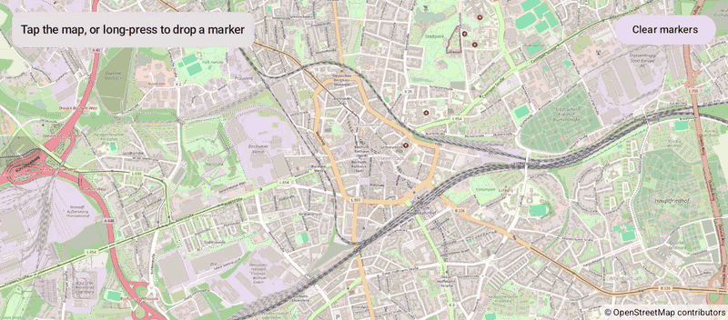

# Clicks (Compose)

[Back to README](../../../README.md) | Same app with Views and Java: [Clicks (Views)](../../views/Clicks)

Tap the map to see the coordinates of the tapped point, long-press to drop a numbered marker, tap a marker to open its info window.
The map is the `OpenMap` composable from `de.afarber:openmapview-compose`.

## Features

- `OpenMap(onMapClick, onMapLongClick)` report the `LatLng` under the finger, also at a fractional zoom (the camera starts at 14.5)
- A `Circle` marks the last tap; a changed `center` moves the same circle on the map
- Long presses add `Marker`s from a `mutableStateListOf`; their info windows show the coordinates
- A long press is no click: lifting the finger after a long press doesn't report a tap
- Clear empties the list, which removes the markers

## Screenshot



## Run

Select `examples.compose.Clicks` in Android Studio, or:

```bash
./gradlew :examples:compose:Clicks:installDebug
adb shell am start -n de.afarber.openmapview.examples.compose.clicks/.MainActivity
```

## Code Highlights

```kotlin
OpenMap(
    cameraPositionState = cameraPositionState,
    onMapClick = { lastTap = it },
    onMapLongClick = { drops.add(Drop(nextNumber++, it)) },
) {
    // A changed center moves the same circle on the map
    lastTap?.let { Circle(center = it, radius = 80f) }
    drops.forEach { drop ->
        key(drop.number) {
            Marker(state = rememberMarkerState(drop.position), title = "Marker ${drop.number}")
        }
    }
}
```

## What to Try

1. Tap anywhere: the circle jumps there and the status shows the coordinates
2. Long-press a few times to drop markers, then tap one of them
3. Tap Clear markers
