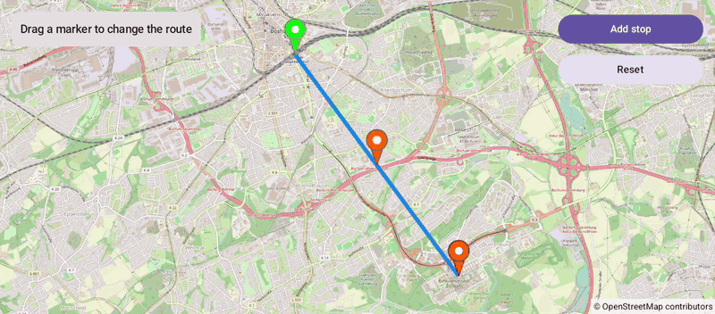

# DraggableMarkers (Compose)

[Back to README](../../../README.md) | Same app with Views and Java: [DraggableMarkers (Views)](../../views/DraggableMarkers)

A route from the main station to the university with draggable markers. Drag a marker and the route follows it; add stops or reset the route.
The map is the `OpenMap` composable from `de.afarber:openmapview-compose`.

## Features

- `Marker(draggable = true)`: a drag starts when a finger moves on the marker or long presses it
- `MarkerState.position` follows the drag, and `MarkerState.isDragging` tells when a drag starts and ends
- The `Polyline` reads the marker positions, so the route follows the dragged marker
- Add stop and Reset change a `mutableStateListOf` of stops

## Screenshot



## Run

Select `examples.compose.DraggableMarkers` in Android Studio, or:

```bash
./gradlew :examples:compose:DraggableMarkers:installDebug
adb shell am start -n de.afarber.openmapview.examples.compose.draggablemarkers/.MainActivity
```

## Code Highlights

```kotlin
OpenMap(cameraPositionState = cameraPositionState) {
    // Reads the marker positions, so the route follows the dragged marker
    Polyline(points = route.map { it.state.position }, strokeColor = Color(0xFF1E88E5), strokeWidth = 8f)
    route.forEach { stop ->
        key(stop.id) {
            Marker(state = stop.state, title = stop.title, draggable = true)
        }
    }
}

// isDragging is true from drag start to drag end
val dragging = route.firstOrNull { it.state.isDragging }
```

## What to Try

1. Drag the orange stop and watch the route and the status
2. Tap Add stop and drag the new marker
3. Tap Reset
