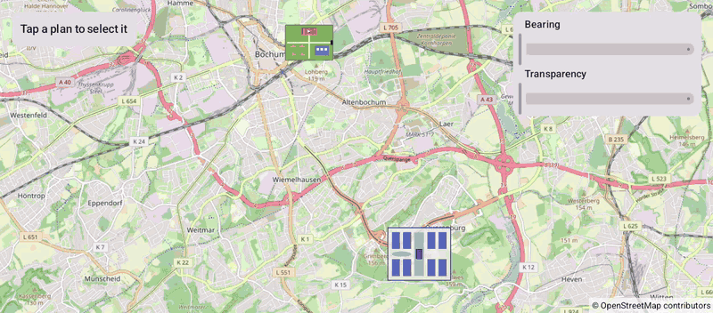

# GroundOverlays (Compose)

[Back to README](../../../README.md) | Same app with Views and Java: [GroundOverlays (Views)](../../views/GroundOverlays)

Two site plans placed on the map as ground overlays: a festival plan by position and size, and a campus plan stretched over its bounds. Tap a plan and rotate it or make it transparent.
The map is the `OpenMap` composable from `de.afarber:openmapview-compose`.

## Features

- `GroundOverlay` composables placed by `position` and `width` in meters, or by `bounds`
- Images from vector drawables with `BitmapDescriptorFactory.fromResource()`
- `onClick` selects a plan
- Changed `bearing` and `transparency` parameters update the same overlay on the map while the sliders move
- The images scale with the map, as they are sized in meters

## Screenshot



## Run

Select `examples.compose.GroundOverlays` in Android Studio, or:

```bash
./gradlew :examples:compose:GroundOverlays:installDebug
adb shell am start -n de.afarber.openmapview.examples.compose.groundoverlays/.MainActivity
```

## Code Highlights

```kotlin
OpenMap(cameraPositionState = cameraPositionState) {
    // Placed by position: the image is 1 km wide at the Stadtpark, its height follows the image
    GroundOverlay(
        image = BitmapDescriptorFactory.fromResource(R.drawable.plan_festival),
        position = FESTIVAL_POSITION,
        width = 1000f,
        bearing = festival.bearing,
        transparency = festival.transparency,
        clickable = true,
        onClick = { selected = festival },
    )
    // Placed by bounds: the image is stretched over the area of the campus
    GroundOverlay(
        image = BitmapDescriptorFactory.fromResource(R.drawable.plan_campus),
        bounds = CAMPUS_BOUNDS,
        bearing = campus.bearing,
        clickable = true,
        onClick = { selected = campus },
    )
}
```

## What to Try

1. Tap the festival plan and drag both sliders
2. Tap the campus plan and rotate it
3. Zoom in and out: the plans keep their size on the ground
