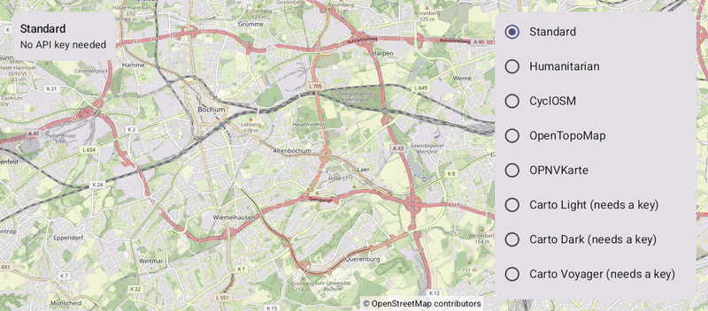

# MapTypes (Compose)

[Back to README](../../../README.md) | Same app with Views and Java: [MapTypes (Views)](../../views/MapTypes)

All 15 map types in a list: OpenStreetMap styles, CARTO, Thunderforest, Tracestrack, Stamen and no base map at all. The status shows whether the selected type needs an API key.
The map is the `OpenMap` composable from `de.afarber:openmapview-compose`.

## Features

- `MapProperties(mapType = ...)` with the `MapType` constants and their names from `TileSource.getMapTypeName()`
- The attribution in the bottom-left corner changes with the map type
- Each map type keeps its own tile cache, so switching back shows its tiles right away
- Map types that need an API key without one show the standard map with a notice; `TileSource.hasApiKey()` and `getProviderName()` explain it in the status
- A `LazyColumn` of radio rows, and `contentPadding` keeps the notice clear of it

## Screenshot



## API Keys

Keys go into the app manifest or are set with `ApiKeyManager.setApiKey()`, see [Map Types](../../../docs/MAP_TYPES.md):

```xml
<meta-data android:name="de.afarber.openmapview.CARTO_API_KEY" android:value="..." />
```

## Run

Select `examples.compose.MapTypes` in Android Studio, or:

```bash
./gradlew :examples:compose:MapTypes:installDebug
adb shell am start -n de.afarber.openmapview.examples.compose.maptypes/.MainActivity
```

## Code Highlights

```kotlin
var mapType by rememberSaveable { mutableIntStateOf(MapType.STANDARD) }

OpenMap(
    cameraPositionState = cameraPositionState,
    // Each map type keeps its own tile cache, so switching back shows its tiles right away
    properties = MapProperties(mapType = mapType),
    contentPadding = PaddingValues(end = LIST_PADDING),
)
```

## What to Try

1. Tap through the free map types: Humanitarian, CyclOSM, OpenTopoMap, OPNVKarte
2. Tap a type that needs a key, e.g. Carto Light
3. Scroll down and tap None
