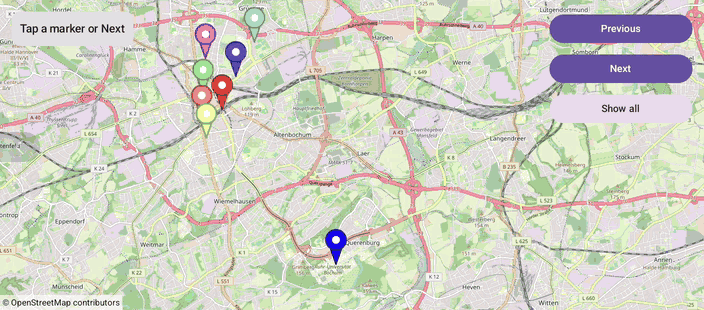

# Markers (Compose)

[Back to README](../../../README.md) | Same app with Views and Java: [Markers (Views)](../../views/Markers)

Eight places in Bochum as colored markers with info windows. Step through them with Previous and Next, tap them, or show all.
The content padding keeps the selected marker in the free area next to the button panel.
The map is the `OpenMap` composable from `de.afarber:openmapview-compose`.

## Features

- `Marker` composables in eight colors with `BitmapDescriptorFactory.defaultMarker(hue)`; title and snippet appear in the info window
- Tapping a marker opens its info window and moves the camera there; `onClick` returns false to keep this default
- Previous and Next call `MarkerState.showInfoWindow()` and the suspending `CameraPositionState.animate(...)`
- Show all hides the info window and fits all places with `newLatLngBounds()`
- `OpenMap(contentPadding)` for the panel, so the camera centers in the area left of it
- A status card with the selection and the last `onInfoWindowClick` / `onInfoWindowClose` event

## Screenshot



## Run

Select `examples.compose.Markers` in Android Studio, or:

```bash
./gradlew :examples:compose:Markers:installDebug
adb shell am start -n de.afarber.openmapview.examples.compose.markers/.MainActivity
```

## Code Highlights

```kotlin
val markerStates = remember { PLACES.map { MarkerState(it.position) } }

OpenMap(
    cameraPositionState = cameraPositionState,
    // The camera centers in the area left of the panel, so the selected marker isn't hidden
    contentPadding = PaddingValues(end = PANEL_PADDING),
) {
    PLACES.forEachIndexed { index, place ->
        Marker(
            state = markerStates[index],
            title = place.title,
            snippet = place.snippet,
            icon = BitmapDescriptorFactory.defaultMarker(place.hue),
            // Returning false keeps the default: the info window opens and the camera moves there
            onClick = { selected = index; false },
            onInfoWindowClick = { event = "Info window tapped: ${place.title}" },
            onInfoWindowClose = { event = "Info window closed: ${place.title}" },
        )
    }
}

// Next: only one info window is shown at a time, so this closes the previous one
markerStates[index].showInfoWindow()
scope.launch { cameraPositionState.animate(CameraUpdateFactory.newLatLng(PLACES[index].position), 1000) }
```

## What to Try

1. Tap Next a few times: each marker's info window opens left of the panel
2. Tap the open info window, then tap Next again: the status shows both events
3. Tap Show all, then tap a marker on the map
