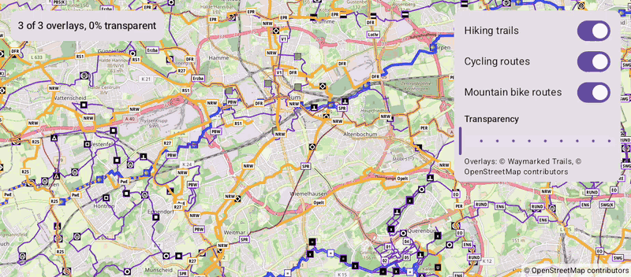

# Overlays (Compose)

[Back to README](../../../README.md) | Same app with Views and Java: [Overlays (Views)](../../views/Overlays)

Hiking trails, cycling routes and mountain bike routes from the public Waymarked Trails service, drawn as tile overlays over the base map. Turn them on and off and change their transparency.
The map is the `OpenMap` composable from `de.afarber:openmapview-compose`.

## Features

- `TileOverlay` composables with the providers in `PredefinedTileProviders`: Waymarked Trails hiking, cycling and mountain bike routes
- Changed `visible` and `transparency` parameters update the same overlay on the map, which keeps its downloaded tiles
- The providers are remembered, so recompositions don't replace the overlays
- A `Slider` sets the transparency of all overlays while dragging
- The overlay service is credited, as its license requires

## Screenshot



## Run

Select `examples.compose.Overlays` in Android Studio, or:

```bash
./gradlew :examples:compose:Overlays:installDebug
adb shell am start -n de.afarber.openmapview.examples.compose.overlays/.MainActivity
```

## Code Highlights

```kotlin
// Remembered, so recompositions keep the overlays and their downloaded tiles
val providers = remember {
    listOf(
        PredefinedTileProviders.waymarkedTrailsHiking(),
        PredefinedTileProviders.waymarkedTrailsCycling(),
        PredefinedTileProviders.waymarkedTrailsMtb(),
    )
}

OpenMap(cameraPositionState = cameraPositionState) {
    providers.forEachIndexed { index, provider ->
        // A changed transparency or visibility updates the same overlay
        TileOverlay(tileProvider = provider, transparency = transparency, visible = visible[index])
    }
}
```

## What to Try

1. Turn the cycling and mountain bike routes off and on again
2. Drag the transparency slider
