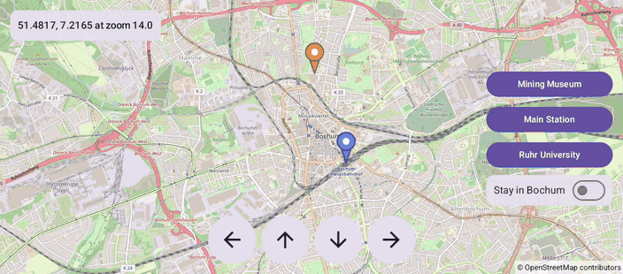

# Pan (Compose)

[Back to README](../../../README.md) | Same app with Views and Java: [Pan (Views)](../../views/Pan)

Pan the map by finger, with an arrow pad, or fly to places in Bochum. A switch keeps the camera inside Bochum.
The map is the `OpenMap` composable from `de.afarber:openmapview-compose`.

## Features

- `OpenMap` with a `CameraPositionState` that survives configuration changes
- `Marker` composables in three colors, with `BitmapDescriptorFactory.defaultMarker(hue)`
- Buttons that fly to a place with the suspending `CameraPositionState.animate(...)`
- An arrow pad that pans by pixels with `CameraUpdateFactory.scrollBy(x, y)`
- "Stay in Bochum": `MapProperties(latLngBoundsForCameraTarget)` limits the camera, a conditional `Polygon` outlines the area and `newLatLngBounds()` zooms out to show it
- A status card that reads `cameraPositionState.position`, so only the card recomposes while the map moves

## Screenshot



## Run

Select `examples.compose.Pan` in Android Studio, or:

```bash
./gradlew :examples:compose:Pan:installDebug
adb shell am start -n de.afarber.openmapview.examples.compose.pan/.MainActivity
```

## Code Highlights

```kotlin
val cameraPositionState = rememberCameraPositionState { position = CameraPosition(CITY_HALL, 14f) }
var stayInBochum by rememberSaveable { mutableStateOf(false) }

OpenMap(
    cameraPositionState = cameraPositionState,
    // A null area lets the camera go anywhere again
    properties = MapProperties(latLngBoundsForCameraTarget = if (stayInBochum) BOCHUM_AREA else null),
) {
    // Shapes come and go with the composition, like any other UI
    if (stayInBochum) {
        Polygon(points = BOCHUM_OUTLINE, strokeColor = Color(0xFF1565C0), fillColor = Color(0x201565C0))
    }
}

// Panning by pixels, e.g. for a d-pad or rotary controller in a car
scope.launch { cameraPositionState.animate(CameraUpdateFactory.scrollBy(-PAN_STEP, 0f), 300) }
```

## What to Try

1. Drag the map and watch the coordinates in the status card
2. Tap Mining Museum, Main Station and Ruhr University
3. Pan with the arrow buttons
4. Turn on "Stay in Bochum" and try to drag the map center out of the blue rectangle
