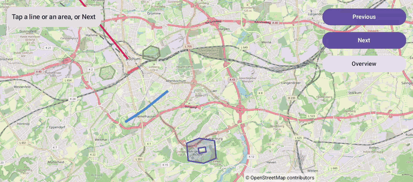

# Polylines (Compose)

[Back to README](../../../README.md) | Same app with Views and Java: [Polylines (Views)](../../views/Polylines)

Lines and areas in Bochum, a polygon with a hole, and a geodesic flight to Reykjavik. Tap a shape or step through them: the selected one stands out and the camera fits it.
The map is the `OpenMap` composable from `de.afarber:openmapview-compose`.

## Features

- `Polyline` and `Polygon` composables, with `holes` for a polygon with a hole
- A geodesic polyline next to a dashed straight one, with `geodesic = true` and `strokePattern = PathEffect.dashPathEffect(...)`
- `onClick` on clickable shapes selects them
- Highlighting by changing `strokeWidth`, `fillColor` and `zIndex`: the shapes are updated in place on the map
- The camera fits the selected shape with `newLatLngBounds()` into the area that `contentPadding` leaves free of the status card and the panel, and `CameraPositionState.move()` fits all shapes when the screen appears

## Screenshot



## Run

Select `examples.compose.Polylines` in Android Studio, or:

```bash
./gradlew :examples:compose:Polylines:installDebug
adb shell am start -n de.afarber.openmapview.examples.compose.polylines/.MainActivity
```

## Code Highlights

```kotlin
OpenMap(
    cameraPositionState = cameraPositionState,
    // Neither the status card nor the panel covers the selected shape
    contentPadding = PaddingValues(top = cardBottom, end = PANEL_PADDING),
) {
    ITEMS.forEachIndexed { index, item ->
        val highlighted = index == selected
        // A changed parameter updates the shape on the map, so it stands out right away
        when (item) {
            is Line -> Polyline(
                points = item.points,
                strokeColor = item.color,
                strokeWidth = if (highlighted) item.width * 2 else item.width,
                geodesic = item.geodesic,
                clickable = true,
                onClick = { select(index) },
            )
            is Area -> Polygon(
                points = item.points,
                holes = item.holes,
                strokeColor = item.strokeColor,
                fillColor = item.strokeColor.copy(alpha = if (highlighted) 0.56f else 0.25f),
                clickable = true,
                onClick = { select(index) },
            )
        }
    }
}
```

## What to Try

1. Tap the blue cycle path or one of the parks
2. Tap Next until Ruhr University: the polygon has a hole
3. Tap Next once more: the geodesic flight curves north of the dashed straight line
