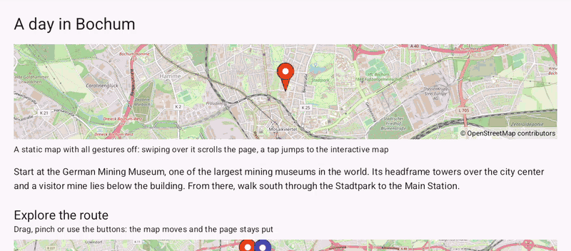

# ScrollingPage (Compose)

[Back to README](../../../README.md) | Same app with Views and Java: [ScrollingPage (Views)](../../views/ScrollingPage)

A scrolling text page about a day in Bochum with two maps among the paragraphs: a static preview that lets the page scroll over it, and an interactive map that keeps its gestures while the page stays put.
The maps are `OpenMap` composables from `de.afarber:openmapview-compose` inside a `Column` with `verticalScroll`.

## Features

- A static preview map with pan and zoom gestures off through `MapUiSettings`: a swipe over it scrolls the page
- A tap on the preview still reaches `onMapClick` and scrolls down to the interactive map with `ScrollState.animateScrollTo()`
- The interactive map with markers, a route and zoom buttons: while a finger pans or pinches it, the map keeps the page from scrolling
- The camera position under the map, updated while the map moves

## Screenshot



## Run

Select `examples.compose.ScrollingPage` in Android Studio, or:

```bash
./gradlew :examples:compose:ScrollingPage:installDebug
adb shell am start -n de.afarber.openmapview.examples.compose.scrollingpage/.MainActivity
```

## Code Highlights

```kotlin
Column(modifier = Modifier.fillMaxSize().verticalScroll(scrollState).padding(24.dp)) {
    // With its gestures off the map never claims a drag, so the page scrolls over it
    OpenMap(
        modifier = Modifier.fillMaxWidth().height(180.dp),
        uiSettings = MapUiSettings(zoomGesturesEnabled = false, scrollGesturesEnabled = false),
        // Taps still arrive
        onMapClick = { scope.launch { scrollState.animateScrollTo(interactiveTop) } },
    )

    // The interactive map keeps its gestures: the page stays put while it is dragged
    OpenMap(
        modifier = Modifier.fillMaxWidth().height(300.dp),
        cameraPositionState = cameraPositionState,
        uiSettings = MapUiSettings(zoomControlsEnabled = true),
    ) {
        Polyline(points = listOf(MINING_MUSEUM, PLANETARIUM, MAIN_STATION, RUHR_UNIVERSITY))
    }
}
```

## What to Try

1. Swipe up over the static map: the page scrolls
2. Swipe over the interactive map in any direction: only the map moves
3. Scroll back up and tap the static map to jump to the interactive one
