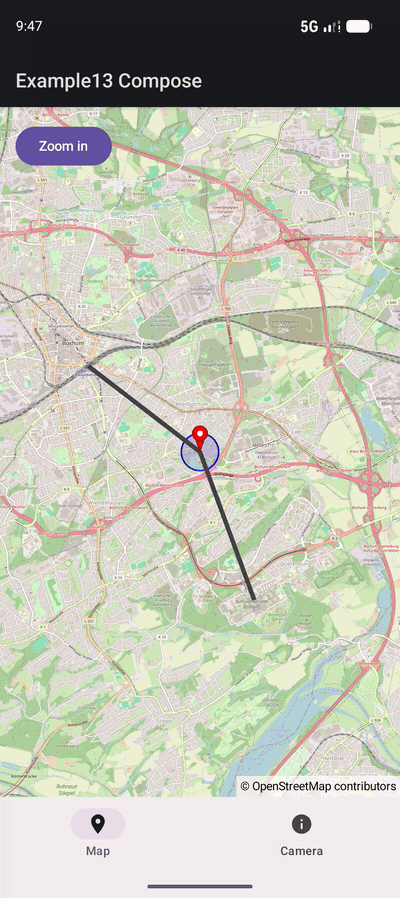

# Tabs (Compose) - OpenMap Composable

[Back to README](../../../README.md)

This example shows the `OpenMap` composable from the optional `de.afarber:openmapview-compose` artifact in an app with two tabs.

## Features Demonstrated

- `OpenMap` without any lifecycle code or `Modifier.clipToBounds()`
- `rememberCameraPositionState` hoisted above the tabs, so the map keeps its camera when the map tab is left and shown again
- Moving the camera by setting `CameraPositionState.position` from another tab
- Animating the camera with the suspending `CameraPositionState.animate`
- A draggable `Marker` declared in `OpenMap`'s content, its `MarkerState` hoisted like the camera
- A `Circle` that follows the dragged marker, as a changed parameter replaces the shape
- A clickable `Polyline` route that changes color when tapped

## Screenshot



## Quick Start

### Option 1: Run in Android Studio

1. Open the OpenMapView project in Android Studio
2. Select `examples.compose.Tabs` from the run configuration dropdown
3. Click Run (green play button)
4. Deploy to your device or emulator

### Option 2: Build and Install from Command Line

```bash
./gradlew :examples:compose:Tabs:installDebug
adb shell am start -n de.afarber.openmapview.examples.compose.tabs/.MainActivity
```

## Code Highlights

```kotlin
@Composable
fun TabsScreen() {
    var selectedTab by rememberSaveable { mutableIntStateOf(0) }

    // Hoisted above the tabs: the map is created again on every visit of the map tab,
    // but keeps its camera
    val cameraPositionState = rememberCameraPositionState {
        position = CameraPosition(BOCHUM, 14f)
    }
    // Also hoisted, so the dragged marker keeps its position
    val markerState = rememberMarkerState(BOCHUM)

    Scaffold(bottomBar = { /* Map and Camera tabs */ }) { padding ->
        Box(modifier = Modifier.padding(padding)) {
            when (selectedTab) {
                0 -> MapTab(cameraPositionState, markerState)
                else -> CameraTab(cameraPositionState, markerState) { selectedTab = 0 }
            }
        }
    }
}

@Composable
fun MapTab(cameraPositionState: CameraPositionState, markerState: MarkerState) {
    val scope = rememberCoroutineScope()

    Box(modifier = Modifier.fillMaxSize()) {
        OpenMap(
            modifier = Modifier.fillMaxSize(),
            cameraPositionState = cameraPositionState,
        ) {
            Marker(state = markerState, title = "Drag me", draggable = true)
        }
        Button(onClick = { scope.launch { cameraPositionState.animate(CameraUpdateFactory.zoomIn()) } }) {
            Text("Zoom in")
        }
    }
}
```

## What to Try

1. Pan and zoom the map and drag the marker, then switch to the Camera tab: it shows the current camera and marker positions
2. Switch back to the Map tab: the new map starts at the same position, with the marker where you left it
3. Tap "Back to Bochum" on the Camera tab: the map tab opens at the initial camera and marker position
4. Tap "Zoom in" for an animated zoom
5. Tap the gray route to select it, and again to deselect it

## Notes

`OpenMap` sets the camera move and idle listeners and the marker click and drag listeners of the map. Observe the camera through `cameraPositionState.position` (e.g. with `snapshotFlow`) and markers through their `MarkerState` and `onClick` instead of setting those listeners in `onMapCreated`.
