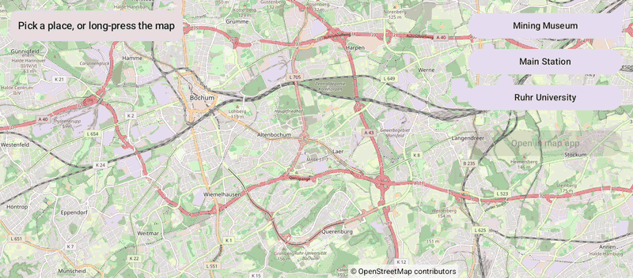

# Toolbar (Compose)

[Back to README](../../../README.md) | Same app with Views and Java: [Toolbar (Views)](../../views/Toolbar)

Pick a place or long-press the map, then hand it to another map app for navigation. Without a map app, OpenStreetMap.org opens in the browser instead; a car without a browser shows the link as a QR code to scan with a phone.
The map is the `OpenMap` composable from `de.afarber:openmapview-compose`.

## Features

- `openLocationInExternalApp(target, zoom, context, label)` opens the camera target through a `geo:` URI, with the label as the pin title
- The browser fallback marks the place on OpenStreetMap.org; no `<queries>` manifest entry is needed
- Three place buttons and `OpenMap(onMapLongClick)` to drop a pin anywhere
- The camera flies to the selected place, centered next to the panel with `contentPadding`

## Screenshot



The emulator has no map app, so the link opens in the car's Link Viewer as a QR code.

## Run

Select `examples.compose.Toolbar` in Android Studio, or:

```bash
./gradlew :examples:compose:Toolbar:installDebug
adb shell am start -n de.afarber.openmapview.examples.compose.toolbar/.MainActivity
```

## Code Highlights

```kotlin
OpenMap(
    cameraPositionState = cameraPositionState,
    onMapLongClick = { select(Place("Dropped pin", it)) },
)

Button(onClick = {
    // Opens the camera target in a map app through a geo: URI, with the name as the pin title
    val position = cameraPositionState.position
    openLocationInExternalApp(position.target, position.zoom, context, selected?.name)
}) { Text("Open in map app") }
```

See [Map Toolbar](../../../docs/MAP_TOOLBAR.md) for the URI formats and the fallback.

## What to Try

1. Tap Main Station, then Open in map app
2. Long-press somewhere on the map and open the dropped pin
