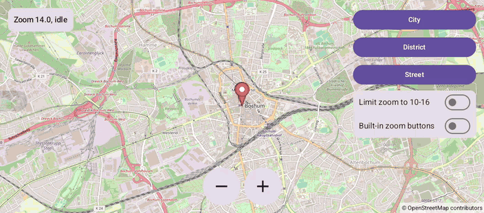

# Zoom (Compose)

[Back to README](../../../README.md) | Same app with Views and Java: [Zoom (Views)](../../views/Zoom)

Zoom by pinching, with big +/- buttons or to preset levels, limit the zoom range and show the map's own zoom buttons.
A status card shows the zoom level and why the camera moves.
The map is the `OpenMap` composable from `de.afarber:openmapview-compose`.

## Features

- Smooth pinch zoom, which also pans when both fingers move
- +/- buttons that animate `CameraUpdateFactory.zoomIn()` and `zoomOut()` with the suspending `CameraPositionState.animate()`
- City, District and Street buttons that animate `CameraUpdateFactory.zoomTo(12 / 14 / 17)`
- "Limit zoom to 10-16" with `MapProperties(minZoomPreference, maxZoomPreference)`; the map edges glow when a pinch goes past the limit
- "Built-in zoom buttons" with `MapUiSettings(zoomControlsEnabled)`
- A status card that reads `cameraPositionState.position`, `isMoving` and `cameraMoveStartedReason`

## Screenshot



## Run

Select `examples.compose.Zoom` in Android Studio, or:

```bash
./gradlew :examples:compose:Zoom:installDebug
adb shell am start -n de.afarber.openmapview.examples.compose.zoom/.MainActivity
```

## Code Highlights

```kotlin
var limitZoom by rememberSaveable { mutableStateOf(false) }
var zoomButtons by rememberSaveable { mutableStateOf(false) }

OpenMap(
    cameraPositionState = cameraPositionState,
    // Zooming in or out beyond the limits makes the map edges glow
    properties = if (limitZoom) MapProperties(minZoomPreference = 10f, maxZoomPreference = 16f) else MapProperties(),
    // The +/- buttons drawn by the map itself, at the bottom right
    uiSettings = MapUiSettings(zoomControlsEnabled = zoomButtons),
)

// Why the camera moves: a gesture, the app or the map's own buttons
val state = when {
    !cameraPositionState.isMoving -> "idle"
    cameraPositionState.cameraMoveStartedReason == CameraMoveStartedReason.GESTURE -> "moving by gesture"
    cameraPositionState.cameraMoveStartedReason == CameraMoveStartedReason.API_ANIMATION -> "moving by the map"
    else -> "moving by the app"
}
```

## What to Try

1. Pinch to zoom, and move both fingers while pinching to pan at the same time
2. Tap +/- and watch the status say "moving by the app"
3. Tap Street, then turn on "Limit zoom to 10-16": the map zooms out to 16
4. Turn on "Built-in zoom buttons" and use them: the status says "moving by the map"
