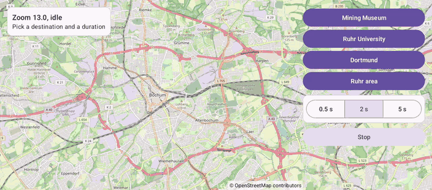

# Camera (Views)

[Back to README](../../../README.md) | Same app in Jetpack Compose: [Camera (Compose)](../../compose/Camera)

Fly to four destinations at different zoom levels, in 0.5, 2 or 5 seconds. Stop a flight, interrupt it with another one or with a tap on the map, and watch the callbacks.
The map is declared in an XML layout and driven from a Java `AppCompatActivity`.

## Features

- `animateCamera(CameraUpdateFactory.newLatLngZoom(...), durationMs, callback)`: the camera moves and zooms at the same time
- A `CancelableCallback` reports "Finished" from `onFinish()` and "Canceled" from `onCancel()`
- Stop calls `stopAnimation()`; a new flight or a touch on the map cancels the running one too
- A status card with the zoom and why the camera moves, from the camera move started, move, idle and canceled listeners
- `setMapPadding()` keeps the destination clear of the button panel

## Screenshot



## Run

Select `examples.views.Camera` in Android Studio, or:

```bash
./gradlew :examples:views:Camera:installDebug
adb shell am start -n de.afarber.openmapview.examples.views.camera/.MainActivity
```

## Code Highlights

```java
// A new animation, a tap on the map or Stop interrupts this one
mapView.animateCamera(CameraUpdateFactory.newLatLngZoom(target, zoom), durationMs, new CancelableCallback() {
    @Override
    public void onFinish() {
        callbackText.setText(getString(R.string.finished, name, duration));
    }

    @Override
    public void onCancel() {
        callbackText.setText(getString(R.string.canceled, name));
    }
});

// Stops the running animation: its callback gets onCancel()
findViewById(R.id.button_stop).setOnClickListener(v -> mapView.stopAnimation());
```

## What to Try

1. Pick 5 s and fly to Dortmund, then tap Stop halfway
2. Fly to the Ruhr area and tap Mining Museum before it arrives
3. Tap the map during a flight
