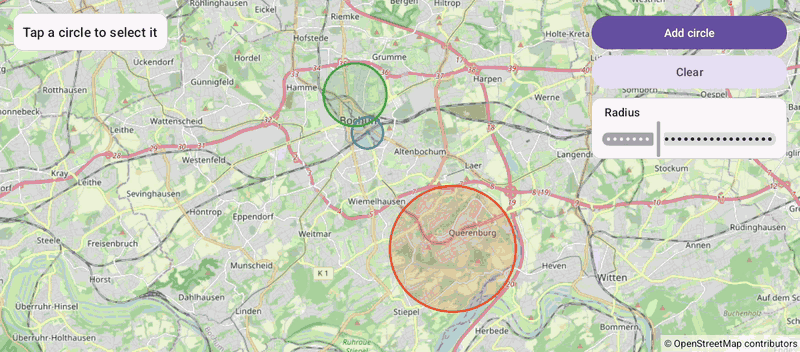

# Circles (Views)

[Back to README](../../../README.md) | Same app in Jetpack Compose: [Circles (Compose)](../../compose/Circles)

Circles around places in Bochum with radii in meters. Tap a circle to select it, change its radius with the slider, add circles or clear them.
The map is declared in an XML layout and driven from a Java `AppCompatActivity`.

## Features

- Circles with `CircleOptions`: a center, a radius in meters, int stroke and fill colors
- Taps on clickable circles through `setOnCircleClickListener`; where circles overlap, the topmost one gets the tap
- The circles are live: `setRadius()`, `setStrokeWidth()` and `setZIndex()` redraw the map right away
- A Material slider changes the selected circle's radius while dragging
- Add circle adds one at the camera target; Clear calls `clearCircles()`

## Screenshot



## Run

Select `examples.views.Circles` in Android Studio, or:

```bash
./gradlew :examples:views:Circles:installDebug
adb shell am start -n de.afarber.openmapview.examples.views.circles/.MainActivity
```

## Code Highlights

```java
// Radii are in meters, so a circle keeps its size on the ground at any zoom
Circle circle = mapView.addCircle(new CircleOptions()
        .center(center)
        .radius(radius)
        .strokeColor(color)
        .fillColor((color & 0x00FFFFFF) | 0x30000000)
        .clickable(true));

// The circles are live: setRadius() redraws the map while the slider moves
slider.addOnChangeListener((s, value, fromUser) -> selected.setRadius(value));
```

## What to Try

1. Tap the green circle and drag the slider
2. Tap the large orange circle at the university
3. Tap Add circle, then Clear
