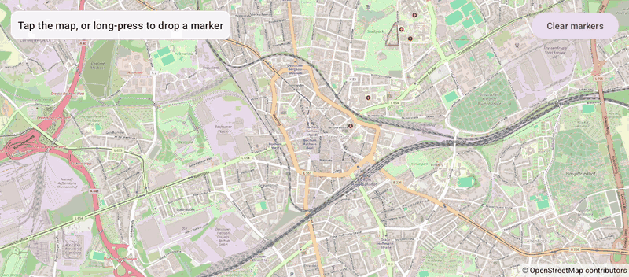

# Clicks (Views)

[Back to README](../../../README.md) | Same app in Jetpack Compose: [Clicks (Compose)](../../compose/Clicks)

Tap the map to see the coordinates of the tapped point, long-press to drop a numbered marker, tap a marker to open its info window.
The map is declared in an XML layout and driven from a Java `AppCompatActivity`.

## Features

- `setOnMapClickListener` and `setOnMapLongClickListener` report the `LatLng` under the finger, also at a fractional zoom (the camera starts at 14.5)
- A circle marks the last tap; it is a live shape, moved with `setCenter()`
- Long presses add markers with `MarkerOptions`; their info windows show the coordinates
- A long press is no click: lifting the finger after a long press doesn't report a tap
- Clear removes the dropped markers with `removeMarker()`

## Screenshot



## Run

Select `examples.views.Clicks` in Android Studio, or:

```bash
./gradlew :examples:views:Clicks:installDebug
adb shell am start -n de.afarber.openmapview.examples.views.clicks/.MainActivity
```

## Code Highlights

```java
// A tap reports its coordinates; the circle is a live shape, moved with a setter
mapView.setOnMapClickListener(latLng -> {
    lastTap.setCenter(latLng);
    status.setText(getString(R.string.tapped, latLng.latitude, latLng.longitude));
});

// A long press drops a numbered marker; tapping it opens its info window
mapView.setOnMapLongClickListener(latLng -> markers.add(mapView.addMarker(
        new MarkerOptions().position(latLng).title(getString(R.string.marker_title, markers.size() + 1)))));
```

## What to Try

1. Tap anywhere: the circle jumps there and the status shows the coordinates
2. Long-press a few times to drop markers, then tap one of them
3. Tap Clear markers
