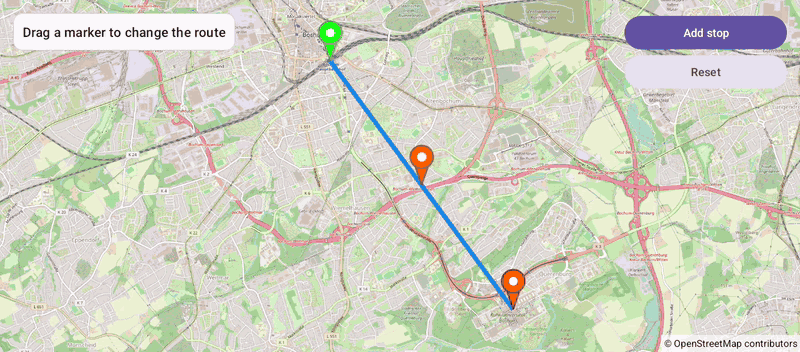

# DraggableMarkers (Views)

[Back to README](../../../README.md) | Same app in Jetpack Compose: [DraggableMarkers (Compose)](../../compose/DraggableMarkers)

A route from the main station to the university with draggable markers. Drag a marker and the route follows it; add stops or reset the route.
The map is declared in an XML layout and driven from a Java `AppCompatActivity`.

## Features

- Draggable markers with `MarkerOptions.draggable(true)`: a drag starts when a finger moves on the marker or long presses it
- `setOnMarkerDragListener` reports drag start, drag and end, shown in the status card
- The route is a live `Polyline`, updated with `setPoints()` on every drag event
- Add stop inserts a marker before the destination; Reset removes the markers with `removeMarker()`

## Screenshot



## Run

Select `examples.views.DraggableMarkers` in Android Studio, or:

```bash
./gradlew :examples:views:DraggableMarkers:installDebug
adb shell am start -n de.afarber.openmapview.examples.views.draggablemarkers/.MainActivity
```

## Code Highlights

```java
mapView.setOnMarkerDragListener(new OnMarkerDragListener() {
    @Override
    public void onMarkerDragStart(Marker marker) {
        status.setText(getString(R.string.drag_started, marker.getTitle()));
    }

    @Override
    public void onMarkerDrag(Marker marker) {
        // The route follows the dragged marker: the polyline is a live shape
        updateLine();
    }

    @Override
    public void onMarkerDragEnd(Marker marker) {
        updateLine();
    }
});
```

## What to Try

1. Drag the orange stop and watch the route and the status
2. Tap Add stop and drag the new marker
3. Tap Reset
