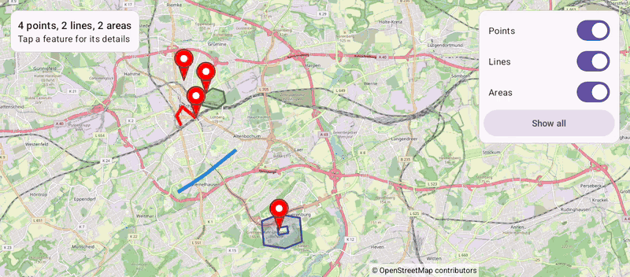

# GeoJson (Views)

[Back to README](../../../README.md) | Same app in Jetpack Compose: [GeoJson (Compose)](../../compose/GeoJson)

Load landmarks, routes and areas in Bochum from a GeoJSON file in the app assets, with the colors and widths stored in the file. Tap a feature to read its name and description, hide points, lines or areas, and fit everything into view again.
The map is declared in an XML layout and driven from a Java `AppCompatActivity`.

## Features

- `addGeoJson()` turns Points into markers, LineStrings into polylines and Polygons (also with holes) into polygons
- Styles from the simplestyle properties `stroke`, `stroke-width`, `fill` and `fill-opacity`
- Each feature's properties end up in the tag of its marker or shape, shown in the status card on tap
- `GeoJsonResult.getBounds()` fits all features below the status card and next to the panel with `setMapPadding()`
- Switches remove and add the markers, and hide the lines and areas through their live setters

## Screenshot



## Run

Select `examples.views.GeoJson` in Android Studio, or:

```bash
./gradlew :examples:views:GeoJson:installDebug
adb shell am start -n de.afarber.openmapview.examples.views.geojson/.MainActivity
```

## Code Highlights

```java
// Points become markers, LineStrings polylines and Polygons polygons
GeoJsonResult result = mapView.addGeoJson(readAsset("bochum.geojson"));

// Each shape's tag holds the properties of its GeoJSON feature
mapView.setOnPolygonClickListener(area -> showFeature(area.getTag()));

// The bounds contain all features
mapView.animateCamera(CameraUpdateFactory.newLatLngBounds(result.getBounds(), 64), 800);
```

## What to Try

1. Tap the green Stadtpark, then the blue cycle path
2. Tap the Ruhr University marker for its info window
3. Turn off Points and Lines, then turn them on again and tap Show all
