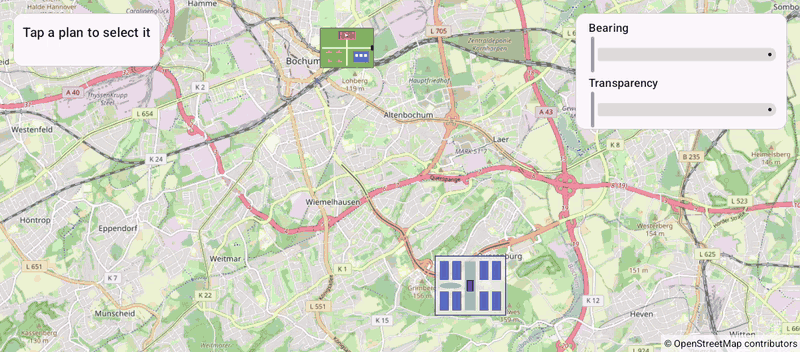

# GroundOverlays (Views)

[Back to README](../../../README.md) | Same app in Jetpack Compose: [GroundOverlays (Compose)](../../compose/GroundOverlays)

Two site plans placed on the map as ground overlays: a festival plan by position and size, and a campus plan stretched over its bounds. Tap a plan and rotate it or make it transparent.
The map is declared in an XML layout and driven from a Java `AppCompatActivity`.

## Features

- Ground overlays with `GroundOverlayOptions`: `position(latLng, widthInMeters)` or `positionFromBounds(bounds)`
- Images from vector drawables with `BitmapDescriptorFactory.fromResource()`
- Taps on clickable overlays through `setOnGroundOverlayClickListener`
- The overlays are live: `setBearing()` and `setTransparency()` redraw the map while the sliders move
- The images scale with the map, as they are sized in meters

## Screenshot



## Run

Select `examples.views.GroundOverlays` in Android Studio, or:

```bash
./gradlew :examples:views:GroundOverlays:installDebug
adb shell am start -n de.afarber.openmapview.examples.views.groundoverlays/.MainActivity
```

## Code Highlights

```java
// Placed by position: the image is 1 km wide at the Stadtpark, its height follows the image
festival = mapView.addGroundOverlay(new GroundOverlayOptions()
        .image(BitmapDescriptorFactory.fromResource(R.drawable.plan_festival))
        .position(new LatLng(51.4840, 7.2310), 1000f)
        .clickable(true));

// Placed by bounds: the image is stretched over the area of the campus
mapView.addGroundOverlay(new GroundOverlayOptions()
        .image(BitmapDescriptorFactory.fromResource(R.drawable.plan_campus))
        .positionFromBounds(new LatLngBounds(new LatLng(51.4400, 7.2540), new LatLng(51.4500, 7.2730)))
        .clickable(true));

// The overlays are live: their setters redraw the map while the sliders move
bearingSlider.addOnChangeListener((s, value, fromUser) -> selected.setBearing(value));
```

## What to Try

1. Tap the festival plan and drag both sliders
2. Tap the campus plan and rotate it
3. Zoom in and out: the plans keep their size on the ground
