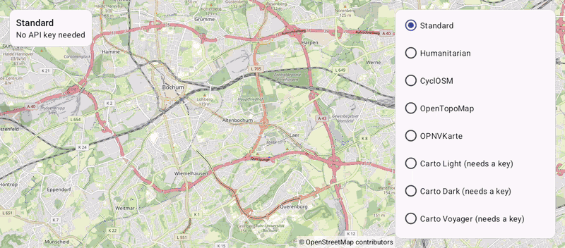

# MapTypes (Views)

[Back to README](../../../README.md) | Same app in Jetpack Compose: [MapTypes (Compose)](../../compose/MapTypes)

All 15 map types in a list: OpenStreetMap styles, CARTO, Thunderforest, Tracestrack, Stamen and no base map at all. The status shows whether the selected type needs an API key.
The map is declared in an XML layout and driven from a Java `AppCompatActivity`.

## Features

- `setMapType()` with the `MapType` constants and their names from `TileSource.getMapTypeName()`
- The attribution in the corner changes with the map type
- Each map type keeps its own tile cache, so switching back shows its tiles right away
- Map types that need an API key without one show the standard map with a notice; `TileSource.hasApiKey()` and `getProviderName()` explain it in the status
- `setMapPadding()` keeps the notice and the attribution clear of the list

## Screenshot



## API Keys

Keys go into the app manifest or are set with `ApiKeyManager.setApiKey()`, see [Map Types](../../../docs/MAP_TYPES.md):

```xml
<meta-data android:name="de.afarber.openmapview.CARTO_API_KEY" android:value="..." />
```

## Run

Select `examples.views.MapTypes` in Android Studio, or:

```bash
./gradlew :examples:views:MapTypes:installDebug
adb shell am start -n de.afarber.openmapview.examples.views.maptypes/.MainActivity
```

## Code Highlights

```java
// Each map type keeps its own tile cache, so switching back shows its tiles right away.
// The attribution in the corner changes with the map type.
mapView.setMapType(MapType.CYCLOSM);

TileSource source = TileSource.fromMapType(mapType);
keyText.setText(source.hasApiKey() ? "Uses your key" : "Needs a " + source.getProviderName() + " API key");
```

## What to Try

1. Tap through the free map types: Humanitarian, CyclOSM, OpenTopoMap, OPNVKarte
2. Tap a type that needs a key, e.g. Carto Light
3. Scroll down and tap None
