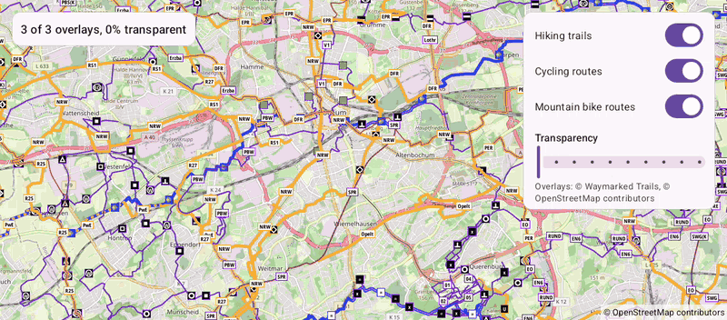

# Overlays (Views)

[Back to README](../../../README.md) | Same app in Jetpack Compose: [Overlays (Compose)](../../compose/Overlays)

Hiking trails, cycling routes and mountain bike routes from the public Waymarked Trails service, drawn as tile overlays over the base map. Turn them on and off and change their transparency.
The map is declared in an XML layout and driven from a Java `AppCompatActivity`.

## Features

- Tile overlays with `TileOverlayOptions` and the providers in `PredefinedTileProviders`: Waymarked Trails hiking, cycling and mountain bike routes
- The overlays are live: `setVisible()` and `setTransparency()` redraw the map right away
- A hidden overlay keeps its downloaded tiles, so showing it again is instant
- A Material slider sets the transparency of all overlays while dragging
- The overlay service is credited, as its license requires

## Screenshot



## Run

Select `examples.views.Overlays` in Android Studio, or:

```bash
./gradlew :examples:views:Overlays:installDebug
adb shell am start -n de.afarber.openmapview.examples.views.overlays/.MainActivity
```

## Code Highlights

```java
TileOverlay overlay = mapView.addTileOverlay(
        new TileOverlayOptions().tileProvider(PredefinedTileProviders.waymarkedTrailsHiking()));

// Hiding an overlay keeps its downloaded tiles, so showing it again is instant
toggle.setOnCheckedChangeListener((button, checked) -> overlay.setVisible(checked));

// The overlays are live: setTransparency() redraws the map and keeps their tiles
slider.addOnChangeListener((s, value, fromUser) -> overlay.setTransparency(value));
```

## What to Try

1. Turn the cycling and mountain bike routes off and on again
2. Drag the transparency slider
