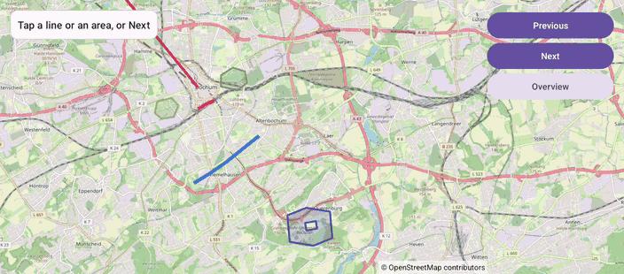

# Polylines (Views)

[Back to README](../../../README.md) | Same app in Jetpack Compose: [Polylines (Compose)](../../compose/Polylines)

Lines and areas in Bochum, a polygon with a hole, and a geodesic flight to Reykjavik. Tap a shape or step through them: the selected one stands out and the camera fits it.
The map is declared in an XML layout and driven from a Java `AppCompatActivity`.

## Features

- Polylines and polygons with `PolylineOptions` and `PolygonOptions`, int colors and `addHole()`
- A geodesic polyline next to a dashed straight one, with `geodesic(true)` and `strokePattern(PathEffect.Companion.dashPathEffect(...))`
- Taps on clickable shapes through `setOnPolylineClickListener` and `setOnPolygonClickListener`; the shape's `tag` holds its index
- Highlighting through the live shape setters: `setWidth()`, `setZIndex()`, `setStrokeWidth()` and `setFillColor()`
- The camera fits the selected shape with `newLatLngBounds()` into the area that `setMapPadding()` leaves free of the status card and the panel

## Screenshot



## Run

Select `examples.views.Polylines` in Android Studio, or:

```bash
./gradlew :examples:views:Polylines:installDebug
adb shell am start -n de.afarber.openmapview.examples.views.polylines/.MainActivity
```

## Code Highlights

```java
// A geodesic line follows the shortest way on the globe, which is curved on the map
flight.line = mapView.addPolyline(new PolylineOptions()
        .add(BOCHUM, REYKJAVIK)
        .color(0xFFD81B60)
        .width(6f)
        .geodesic(true)
        .clickable(true)
        .tag(items.size()));

// Only clickable shapes report taps; the tag holds the index of their item
mapView.setOnPolylineClickListener(line -> select((Integer) line.getTag()));

// The shapes are live: setters redraw the map right away
line.setWidth(highlighted ? width * 2 : width);
area.setFillColor(highlighted ? (fillColor | 0x90000000) : fillColor);
```

## What to Try

1. Tap the blue cycle path or one of the parks
2. Tap Next until Ruhr University: the polygon has a hole
3. Tap Next once more: the geodesic flight curves north of the dashed straight line
