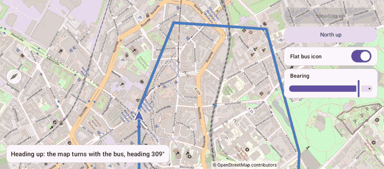

# Rotation (Views)

[Back to README](../../../README.md) | Same app in Jetpack Compose: [Rotation (Compose)](../../compose/Rotation)

A bus drives a loop through Bochum. Heading up, the map turns with the bus like a navigation app; north up, it only follows the bus. Turn the map yourself with two fingers or the slider, and back north with the compass.
The map is declared in an XML layout and driven from a Java `AppCompatActivity`.

## Features

- A camera bearing: `CameraPosition.builder().target(...).zoom(...).bearing(...)` turns the map around the camera target
- Heading up with a top `setMapPadding()`, so the bus drives in the lower part of the map with the road ahead visible
- The bus moves once per display frame in a `Choreographer.FrameCallback`, with `SphericalUtil.interpolate()` and `SphericalUtil.computeHeading()`
- A flat marker (`MarkerOptions.flat(true)`) lies on the map and turns with it; `setFlat(false)` makes it face the screen
- Two-finger rotation and the compass, which shows while the map is turned and turns it back north
- `REASON_GESTURE` in `setOnCameraMoveStartedListener` stops following the bus when the user touches the map

## Screenshot



## Run

Select `examples.views.Rotation` in Android Studio, or:

```bash
./gradlew :examples:views:Rotation:installDebug
adb shell am start -n de.afarber.openmapview.examples.views.rotation/.MainActivity
```

## Code Highlights

```java
// Once per display frame: the bus moves on, and the camera follows it and turns with it
LatLng position = positionAt(distance);
busHeading = turnToward(busHeading, headingAt(distance), TURN_SPEED * seconds);
bus.setPosition(position);
bus.setRotation(busHeading);
mapView.moveCamera(CameraUpdateFactory.newCameraPosition(new CameraPosition(position, camera.zoom, busHeading)));

// Touching the map stops following the bus
mapView.setOnCameraMoveStartedListener(reason -> {
    if (reason == OnCameraMoveStartedListener.REASON_GESTURE) setMode(Mode.FREE);
});
```

## What to Try

1. Watch the map turn with the bus at the corners, then tap North up
2. Turn the map with two fingers or the slider, then tap the compass in the top-left corner
3. Turn off Flat bus icon while heading up: the arrow now faces the screen instead of the road
