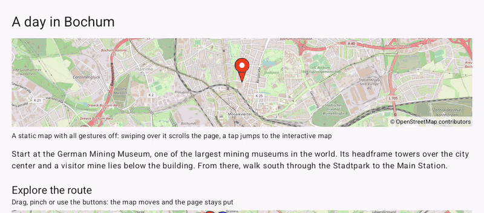

# ScrollingPage (Views)

[Back to README](../../../README.md) | Same app in Jetpack Compose: [ScrollingPage (Compose)](../../compose/ScrollingPage)

A scrolling text page about a day in Bochum with two maps among the paragraphs: a static preview that lets the page scroll over it, and an interactive map that keeps its gestures while the page stays put.
The maps are declared in an XML layout inside a `NestedScrollView` and driven from a Java `AppCompatActivity`.

## Features

- A static preview map with `setAllGesturesEnabled(false)`: a swipe over it scrolls the page
- A tap on the preview still reaches `setOnMapClickListener()` and scrolls down to the interactive map with `smoothScrollTo()`
- The interactive map with markers, a route and zoom buttons: while a finger pans or pinches it, the map keeps the scroll view from taking over the drag
- The camera position under the map, updated from `setOnCameraMoveListener()` while the map moves

## Screenshot



## Run

Select `examples.views.ScrollingPage` in Android Studio, or:

```bash
./gradlew :examples:views:ScrollingPage:installDebug
adb shell am start -n de.afarber.openmapview.examples.views.scrollingpage/.MainActivity
```

## Code Highlights

```java
// With all gestures off the map never claims a drag, so the page scrolls over it
OpenMapView preview = findViewById(R.id.preview_map);
preview.getUiSettings().setAllGesturesEnabled(false);
// Taps still arrive
preview.setOnMapClickListener(latLng -> scroll.smoothScrollTo(0, interactiveTitle.getTop()));

// The interactive map keeps its gestures: the page stays put while it is dragged
mapView.getUiSettings().setZoomControlsEnabled(true);
mapView.setOnCameraMoveListener(() -> {
    CameraPosition camera = mapView.getCameraPosition();
    cameraText.setText(getString(R.string.camera, camera.target.latitude, camera.target.longitude, camera.zoom));
});
```

## What to Try

1. Swipe up over the static map: the page scrolls
2. Swipe over the interactive map in any direction: only the map moves
3. Scroll back up and tap the static map to jump to the interactive one
