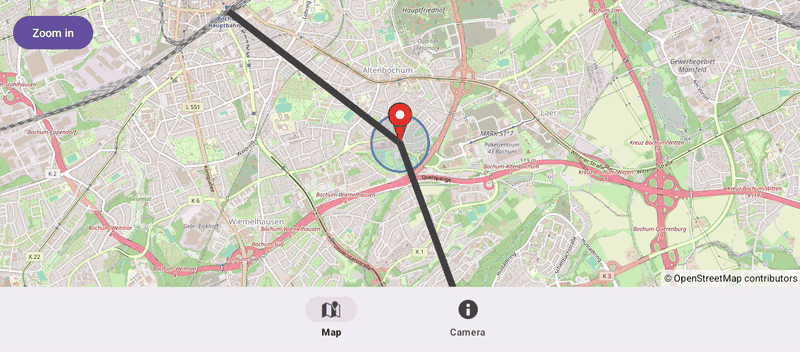

# Tabs (Views)

[Back to README](../../../README.md) | Same app in Jetpack Compose: [Tabs (Compose)](../../compose/Tabs)

A map in one tab of a bottom navigation bar. The map fragment's view is destroyed whenever the tab is left, and a new map starts with the kept camera, marker and route when it is shown again.
The map is declared in an XML layout and driven from Java fragments.

## Features

- `OpenMapView` in a fragment without any lifecycle code: it releases its resources when its view is detached
- The camera, the marker position and the route selection live in an activity-scoped `ViewModel`, so they outlive the map
- The camera is kept from `setOnCameraIdleListener`, so the other tab sees it even though fragments are created before the old view is destroyed
- A draggable marker with a live `Circle` that follows it through `setCenter()`
- A clickable `Polyline` that changes its color with `setColor()`
- The Camera tab shows the kept state and resets it with Back to Bochum

## Screenshot



## Run

Select `examples.views.Tabs` in Android Studio, or:

```bash
./gradlew :examples:views:Tabs:installDebug
adb shell am start -n de.afarber.openmapview.examples.views.tabs/.MainActivity
```

## Code Highlights

```java
// Replacing the fragment destroys the map of the left tab: OpenMapView releases its
// resources when it is detached, without any lifecycle code here
tabs.setOnItemSelectedListener(item -> {
    Fragment tab = item.getItemId() == R.id.tab_map ? new MapFragment() : new CameraFragment();
    getSupportFragmentManager().beginTransaction().replace(R.id.tab_container, tab).commit();
    return true;
});
```

```java
// In MapFragment: a new map on every visit of the tab, which starts at the kept camera
mapView.moveCamera(CameraUpdateFactory.newCameraPosition(state.camera));
mapView.setOnCameraIdleListener(() -> state.camera = mapView.getCameraPosition());
```

## What to Try

1. Pan and zoom the map and drag the marker, then switch to the Camera tab
2. Switch back to the Map tab: the new map starts at the same camera, with the marker where you left it
3. Tap the gray route to select it, switch tabs and back: it stays red
4. Tap Back to Bochum on the Camera tab
