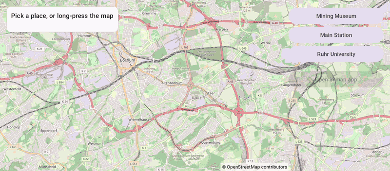

# Toolbar (Views)

[Back to README](../../../README.md) | Same app in Jetpack Compose: [Toolbar (Compose)](../../compose/Toolbar)

Pick a place or long-press the map, then hand it to another map app for navigation. Without a map app, OpenStreetMap.org opens in the browser instead; a car without a browser shows the link as a QR code to scan with a phone.
The map is declared in an XML layout and driven from a Java `AppCompatActivity`.

## Features

- `openInExternalApp(label)` opens the camera target through a `geo:` URI, with the label as the pin title
- The browser fallback marks the place on OpenStreetMap.org; no `<queries>` manifest entry is needed
- Three place buttons and `setOnMapLongClickListener` to drop a pin anywhere
- The camera flies to the selected place, centered next to the panel with `setMapPadding()`

## Screenshot



The emulator has no map app, so the link opens in the car's Link Viewer as a QR code.

## Run

Select `examples.views.Toolbar` in Android Studio, or:

```bash
./gradlew :examples:views:Toolbar:installDebug
adb shell am start -n de.afarber.openmapview.examples.views.toolbar/.MainActivity
```

## Code Highlights

```java
// A long press drops a pin and makes it the camera target
mapView.setOnMapLongClickListener(latLng -> select(getString(R.string.dropped_pin), latLng));

// Opens the camera target in a map app through a geo: URI, with the label as the pin title
openButton.setOnClickListener(v -> mapView.openInExternalApp(label));
```

See [Map Toolbar](../../../docs/MAP_TOOLBAR.md) for the URI formats and the fallback.

## What to Try

1. Tap Main Station, then Open in map app
2. Long-press somewhere on the map and open the dropped pin
