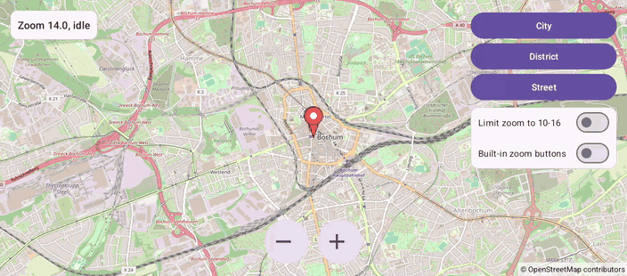

# Zoom (Views)

[Back to README](../../../README.md) | Same app in Jetpack Compose: [Zoom (Compose)](../../compose/Zoom)

Zoom by pinching, with big +/- buttons or to preset levels, limit the zoom range and show the map's own zoom buttons.
A status card shows the zoom level and why the camera moves.
The map is declared in an XML layout and driven from a Java `AppCompatActivity`.

## Features

- Smooth pinch zoom, which also pans when both fingers move
- +/- buttons that animate `CameraUpdateFactory.zoomIn()` and `zoomOut()`
- City, District and Street buttons that animate `CameraUpdateFactory.zoomTo(12 / 14 / 17)`
- "Limit zoom to 10-16" with `setMinZoomPreference()`, `setMaxZoomPreference()` and `resetMinMaxZoomPreference()`; the map edges glow when a pinch goes past the limit
- "Built-in zoom buttons" with `getUiSettings().setZoomControlsEnabled()`
- A status card from `setOnCameraMoveStartedListener` (gesture, app or map buttons), `setOnCameraMoveListener`, `setOnCameraIdleListener` and `setOnCameraMoveCanceledListener`

## Screenshot



## Run

Select `examples.views.Zoom` in Android Studio, or:

```bash
./gradlew :examples:views:Zoom:installDebug
adb shell am start -n de.afarber.openmapview.examples.views.zoom/.MainActivity
```

## Code Highlights

```java
// One level per tap, animated like the built-in zoom buttons
findViewById(R.id.button_zoom_in).setOnClickListener(
        v -> mapView.animateCamera(CameraUpdateFactory.zoomIn(), 300));

// Zooming in or out beyond the limits makes the map edges glow
mapView.setMinZoomPreference(10f);
mapView.setMaxZoomPreference(16f);

// Why the camera moves: a gesture, the app or the map's own buttons
mapView.setOnCameraMoveStartedListener(reason -> {
    moving = true;
    moveReason = reason;
    showStatus();
});
```

## What to Try

1. Pinch to zoom, and move both fingers while pinching to pan at the same time
2. Tap +/- and watch the status say "moving by the app"
3. Tap Street, then turn on "Limit zoom to 10-16": the map zooms out to 16
4. Turn on "Built-in zoom buttons" and use them: the status says "moving by the map"
